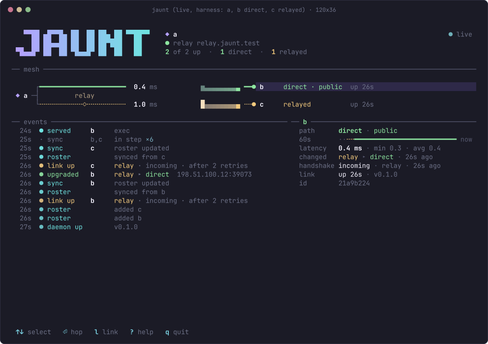
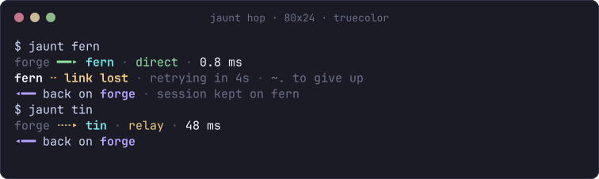

# jaunt

jaunt lets you sit at any of your own machines and open a terminal on any other one: `jaunt fern` puts you in a tmux session on the machine called fern, over a direct encrypted link when one can be made and through a relay you host when it cannot.



*The mesh view (`jaunt` with no arguments), captured from the real binary in the Docker test lab. a reaches b directly (0.4 ms) and c through the relay (1.0 ms).*

Install (no root; one static binary goes to `~/.local/bin/jaunt`). The repository is private for now, so use the GitHub CLI, logged in with `gh auth login`:

```sh
gh repo clone ZahakJ/jaunt && sh jaunt/install.sh --relay https://relay.example.net --name forge
```

Once the repository is public:

```sh
curl -fsSL https://raw.githubusercontent.com/ZahakJ/jaunt/main/install.sh | sh -s -- --relay https://relay.example.net --name forge
```

Neither line has been run yet: the GitHub repository and a release do not exist at the time of writing. What has been run is the same installer on the release file: `sh install.sh --from-file dist/jaunt-x86_64-linux-musl --relay URL --name forge`. The installer checks the binary against the `.sha256` that comes with it, which catches a broken download but not a tampered release.

**Keep your Cloudflare tunnel.** jaunt is new code with no outside review and no real-world use yet. Leave the existing SSH-through-Cloudflare path in place as the way in until jaunt has proven itself on your machines for a while (see [Security](#security)).

Contents: [First ten minutes](#the-first-ten-minutes) · [How it works](#how-it-works) · [Everyday commands](#everyday-commands) · [Getting out and back](#getting-out-and-back) · [Laptops that stay reachable](#laptops-that-stay-reachable-host-mode) · [Security](#security) · [Measured](#measured) · [What was tested](#what-was-tested-and-what-was-not) · [First real-world test](#the-first-real-world-test) · [Revoking a lost laptop](#revoking-a-lost-laptop) · [Decisions](#decisions) · [Uninstall, build, layout](#uninstall)

---

## The first ten minutes

The example: a desktop called **forge** and a laptop called **fern**.

### Before anything: a relay

Every mesh needs one relay: a small server on the internet that introduces your machines to each other and carries the traffic when they cannot reach each other directly. It is the stock `iroh-relay` program, it sees only encrypted traffic, and you have to host it yourself. Nothing is deployed for you.

- To host one: [`deploy/relay/README.md`](deploy/relay/README.md). A small VPS is the recommended option (about 4 to 6 US dollars a month). The relay needs 443/tcp and 7842/udp open; without the UDP port, machines behind home routers never find a direct path and everything goes through the relay.
- To try jaunt first without hosting anything, see [Try it on one machine](#try-it-on-one-machine) below.

### On the desktop (forge)

```sh
sh install.sh --relay https://relay.example.net --name forge   # see the install lines above
jaunt up                                                       # install and start the user service
jaunt link                                                     # shows a code like 4127-tremor-kudos
```

Give the relay at install time, or run `jaunt relay set URL` before anything else. A running daemon switches to the new relay at once, and `jaunt relay set` says when it is connected.


### On the laptop (fern)

```sh
sh install.sh --name fern
jaunt up
jaunt join --relay https://relay.example.net
```

`jaunt join` asks for the code. Type it (spaces instead of dashes and capitals are fine). Do not put the code on the command line: other users of the machine could read it from the process list while the join runs.

Both screens then show the same small picture (the sigil) and three words. Check that they match and press `y` on both. If they do not match, press `n`: someone else is in the middle.


### Use it

```sh
jaunt              # the live mesh view: arrows or j/k to choose, Enter to hop, q to quit
jaunt fern         # open (or re-attach) the tmux session "jaunt" on fern
jaunt ls           # every machine: direct / relay / offline, latency, sessions
```



Leave with **Enter, then `~`, then `.`**. The session stays on fern; `jaunt fern` brings you back to exactly where you were. More in [Getting out and back](#getting-out-and-back).

On the laptop, if you want it to stay reachable with the lid closed while it is plugged in:

```sh
jaunt host on      # on fern
jaunt host status  # what closing the lid would do right now
```

A third machine (moss, tin) joins the same way: `jaunt link` on any machine already in the mesh, `jaunt join` on the new one. Every other machine learns about it without being touched.

### Try it on one machine

This runs two pretend machines on one computer, using a local test relay over plain HTTP. Nothing leaves the computer. It was run like this in a sandbox, with two differences: `iroh-relay` 1.3.0 was already installed (built with the same `cargo install` features), and the tmux socket had another name.

```sh
cargo install iroh-relay@1.3.0 --features server --locked     # the relay program
printf 'http_bind_addr = "127.0.0.1:3340"\nenable_metrics = false\n' > ~/relay-try.toml
iroh-relay --dev -c ~/relay-try.toml &                        # test relay, plain HTTP, local only

export JAUNT_TMUX_SOCKET=jaunt-try                            # keep test sessions off your own tmux
JAUNT_HOME=~/jaunt-try/forge jaunt relay set http://127.0.0.1:3340
JAUNT_HOME=~/jaunt-try/forge jaunt name forge
JAUNT_HOME=~/jaunt-try/fern  jaunt name fern
JAUNT_HOME=~/jaunt-try/forge jaunt link                       # terminal 1
JAUNT_HOME=~/jaunt-try/fern  jaunt join --relay http://127.0.0.1:3340   # terminal 2 (same JAUNT_TMUX_SOCKET)
JAUNT_HOME=~/jaunt-try/forge jaunt fern                       # hop; Enter ~ . to leave
```

`JAUNT_HOME` keeps everything in one directory and away from your real configuration. To clean up: `JAUNT_HOME=~/jaunt-try/forge jaunt down`, the same for fern, stop the relay (`kill %1`), `tmux -L jaunt-try kill-server`, `rm -rf ~/jaunt-try ~/relay-try.toml`.

The same test relay can serve two machines on one home network if it binds to the LAN address instead of 127.0.0.1 (`http_bind_addr = "192.168.1.10:3340"`, each machine using `http://192.168.1.10:3340`). That variant has **not been tried**. A plain-HTTP relay is for trying out only: use the HTTPS relay from `deploy/relay/` for real.

---

## How it works

Each machine runs one background program, the **daemon** (a systemd user service, no root). It holds the machine's secret key and keeps encrypted connections to the other machines open. The `jaunt` command you type talks to the local daemon over a private Unix socket.

```
 your terminal                                               the other machine
 jaunt fern ── unix socket ── daemon ══ QUIC + TLS 1.3 ══ daemon ── pty ── tmux session "jaunt"
                                 │   direct UDP when possible   │
                                 └──── else through the relay ──┘
                                       (it sees ciphertext only)
```

- A machine is known by its public key. Each daemon only accepts machines on its **roster** (the member list), and checks this during the encrypted handshake, before any shell or command code runs.
- The roster is copied to every machine and kept in step automatically. Adding a machine (`link`) or revoking one (`unlink`) on any machine spreads to the rest.
- On the far side, a hop runs `tmux new-session -A`: your session lives in tmux on that machine and survives disconnects, network changes and closed lids. Without tmux there, you get a plain shell and jaunt warns that it will not survive a disconnect.

| Reused (not written here) | Built here |
| --- | --- |
| [iroh](https://iroh.computer) 1.3 and iroh-relay: dialling by public key, hole punching, relay fallback, connection migration | the daemon, roster and its sync, revocation |
| QUIC with TLS 1.3 (rustls, ring), inside iroh | the pairing ritual (assembled from the standard parts on the left) |
| SPAKE2 (RFC 9382, RustCrypto crate), HKDF-SHA256, ChaCha20-Poly1305, ed25519 signatures: for pairing only | shell, command, port-forward and copy services |
| tmux: session persistence | host mode (the lid guard) |
| systemd-logind inhibitor locks: keeping a laptop awake | the CLI, the mesh view and the rest of the look |
| OpenSSH: optional second layer through `jaunt pipe` | |

jaunt contains no transport, NAT traversal or cryptographic protocol of its own. Pairing follows the magic-wormhole design: a short code, a password-authenticated key exchange (SPAKE2), then a sealed exchange of the two machine ids, each signed with that machine's key.

---

## Everyday commands

| Command | Does |
| --- | --- |
| `jaunt` | live mesh view. Arrows or `j`/`k` to choose, Enter to hop, `l` to link, `?` help, `q` quit |
| `jaunt fern` | hop to fern, session `jaunt`. Prefixes work: `jaunt fe` |
| `jaunt fern:work` | hop to fern, session `work` (created if needed) |
| `jaunt ls` / `jaunt ls --json` | machines, path, latency, host state, sessions. Tab-separated when piped |
| `jaunt run fern -- uname -a` | run one command there; output and exit status come back |
| `jaunt cp notes.txt fern:docs/` | copy a file or directory; either side can be `machine:path`. Remote paths are relative to the home directory there |
| `jaunt fwd fern 8080:9090` | make fern's `127.0.0.1:8080` available here at `127.0.0.1:9090` until Ctrl-C. Every user of this machine can use the forwarded port while it runs |
| `jaunt pipe fern [port]` | connect stdin/stdout to a port on fern's loopback (default 22); for `ProxyCommand` |
| `jaunt link` / `jaunt join` | add a machine (above) |
| `jaunt unlink fern` | revoke fern (see [Revoking a lost laptop](#revoking-a-lost-laptop)) |
| `jaunt leave` | take this machine out of the mesh and delete its key |
| `jaunt reset` | new key, empty roster (link again afterwards) |
| `jaunt name moss` | rename this machine; the others see the new name |
| `jaunt relay` / `jaunt relay set URL [URL2]` | show or set the relay for the whole mesh. `--ca FILE` trusts a relay certificate from your own CA |
| `jaunt host on` / `off` / `status` | host mode (below) |
| `jaunt check` | diagnose: key permissions, daemon, relay, UDP, tmux, each peer's path, and a list of every address the daemon has talked to. Never starts the daemon |
| `jaunt up` / `jaunt down` | install and start / stop the user service |
| `jaunt demo` | the mesh view and pairing screens on made-up data |
| `jaunt tmux-setup` | install the tmux snippet (below) |
| `jaunt uninstall` | remove jaunt from this machine |

Inside a hop, the shell gets `JAUNT_FROM` (where you came from) and `JAUNT_MACHINE` (where you are). Typing `jaunt moss` there hops onward from fern to moss.

### The tmux snippet

```sh
jaunt tmux-setup
```

then add this one line to your `~/.tmux.conf` (rihla users: `~/.config/rihla/tmux/local.conf`) and reload tmux:

```
source-file ~/.config/jaunt/jaunt.tmux
```

| Key | Does |
| --- | --- |
| prefix `J` (default prefix is Ctrl-b, so Ctrl-b then Shift-j) | the mesh view in a popup. Enter opens the hop in a **new window named after the machine**, so each machine gets its own window |
| `F12` | hand your keys to the tmux on the other machine. The status bar shows `F12 keys to remote` while this is on. Press `F12` again to get them back |

Nothing else is bound; your prefix and `Ctrl-h/j/k/l` are untouched.

### Nested tmux, for a tmux beginner

If you hop from inside tmux, there are now two tmux programs on your screen: yours (the outer one) and the one on the other machine (inside the window). Your prefix key (Ctrl-b) always goes to the **outer** one first.

- To talk to the **remote** tmux: press `F12` once (with the snippet), then use Ctrl-b as usual; press `F12` again to come back. Without the snippet: press the prefix twice (Ctrl-b Ctrl-b) then the key, which is standard tmux behaviour (not tested with jaunt).
- To detach from the remote tmux: `F12`, then Ctrl-b `d`. You are back in your outer tmux, and the remote session stays.
- When in doubt, `Enter ~ .` always works: it is read by jaunt itself, not by either tmux.

---

## Getting out and back

| You want to | Do | Session on the other machine |
| --- | --- | --- |
| leave a hop | Enter, then `~`, then `.` | kept |
| see the escape keys | Enter, then `~`, then `?` | |
| detach from the remote tmux (not nested) | Ctrl-b, then `d` | kept |
| go back | `jaunt fern` (same session, same screen) | |
| use a second session there | `jaunt fern:work` | separate session |
| end the session for good | type `exit` in the remote shell | ended |
| quit the mesh view | `q` | |
| stop linking | Ctrl-c (or `n` at the question) | |

If the link drops (lid closed, Wi-Fi gone), jaunt keeps your terminal, shows one status line such as `fern ╌ link lost · retrying · ~. to give up`, and re-attaches when fern is back. If typed input gets no answer for 3 seconds and nothing at all has arrived from fern, the bottom line says `no answer for Ns · waiting for the link`.

---

## Laptops that stay reachable (host mode)

`jaunt host on` asks the daemon to keep the laptop awake with the lid closed, **only while it is on mains power and not too hot**. It takes a systemd-logind lock on the lid switch. It never blocks the screen lock. `jaunt host off` gives the lid back. Full details: [`docs/awake.md`](docs/awake.md).

| Condition | What happens |
| --- | --- |
| on mains, temperatures below the limit | lid close does nothing; the laptop stays reachable |
| on battery for 10 s, or a weak charger that lets the battery drain for 60 s | lock released; a closed laptop goes to sleep |
| a CPU sensor at 90 °C or more for 120 s, or any sensor within 5 °C of its critical point | lock released and kept released until you open the lid |
| power or temperature cannot be read, or a sensor read hangs for 2 s | treated as "sleep" |
| the daemon crashes, is killed or hangs | the lock goes with it (a child process tied to the daemon by a pipe; a watchdog for hangs) |
| lock released with the lid closed but logind leaves it awake | jaunt runs `systemctl suspend` itself after 5 s, again a minute later |

`jaunt ls` on any machine shows each laptop's state: `awake`, `will sleep on lid close`, `on battery`, `too hot`.

**Costs.** Battery: none, since the lock is never held on battery. Power on mains: an idle laptop with the lid closed draws roughly 3 to 8 W (an estimate, not measured). Heat: a closed lid traps heat; do not leave a hosting laptop in a bag or on a bed. The heat limit is a backstop, not a cooling plan. jaunt does not turn off the internal display; your compositor can (see `docs/awake.md`).

**Needs.** systemd-logind and a local login since boot: logind only lets a user's service take the lid lock while that user has a local session. After a reboot with nobody logged in, the lock is refused and `jaunt host status` says so.

**Root extras** (optional, in `scripts/root-extras/`, never run by jaunt, each prints what it changes and has an `undo` mode):

| Script | Changes |
| --- | --- |
| `host-polkit-rule.sh install <user>` | a polkit rule so the lock works without a local login after a reboot |
| `logind-lid-on-ac.sh install` | a logind setting that ignores the lid on mains. No heat protection; the polkit rule is better |
| `wake-on-lan.sh install <connection>` | Wake-on-LAN through NetworkManager (works only from the same LAN) |

These scripts pass shellcheck and **have never been run**.

**macOS:** never built, never run. The design says a Mac can only hold `caffeinate` with the lid open; closed-lid hosting needs root there.

| Host mode | Status |
| --- | --- |
| every state change (mains, battery, heat, cable wiggle, weak charger, docked, unknown sensors, hung sensor read) | unit tests on fake sysfs trees and a fake logind |
| taking the real logind lock, releasing it on `host off`, on SIGTERM and within 1 s of `kill -9` | verified on the desktop, sandboxed |
| a real laptop actually sleeping when the lock is released, `systemctl suspend` from the guard, real heat with the lid closed, the watchdog killing a hung daemon, the no-login refusal, the root extras | **not verified**: no laptop was available |

---

## Security

What jaunt protects: a shell as you on every one of your machines. That makes it a front door to everything, so this section is long on purpose.

**Trusted:** the machines on the roster and your user account on each. **Not trusted:** the network, the relay and whoever runs it, any machine not on the roster.

### What is defended

| Threat | How |
| --- | --- |
| someone reading or changing traffic, including the relay | QUIC with TLS 1.3, end to end between the machines' own keys; the relay forwards ciphertext |
| an unknown machine connecting | the handshake proves the peer's key; non-members are refused before any service code runs, and every stream checks again |
| someone who knows the relay URL or a machine id | ids are public keys; knowing one grants nothing |
| someone intercepting a pairing | SPAKE2: one guess per code (1 in 60 million), the code dies on a wrong guess, lives 5 minutes, works once; each side proves it holds the key it claims; the roster is sent only after both people said yes; a joining machine never tries the same code twice |
| a lost laptop, after `jaunt unlink` | permanent tombstone, pushed to every reachable machine and spread by sync; its connections are closed, its commands and shell clients ended; its tmux sessions too with `--kill-sessions` |
| a revoked machine racing a machine that was asleep, frozen, restarted or off the network | after such an absence a daemon first tries to sync with every other member (up to 5 s, once per absence) before it serves a machine shells, commands, ports or copies. Tested in the lab: a freeze, and three network outages with the daemon running |
| a revoked or broken member stuffing the roster to block revocations | roster merges are bounded and take tombstones first |
| other users on the same machine | key and socket are private (0600 in 0700 directories); the client checks the socket's owner; the pairing code is typed, not passed on the command line |
| strings from other machines messing up your terminal | control characters are removed before printing |
| a laptop overheating in a bag | host mode only on mains and below the heat limit; anything unknown means sleep |

### What is not defended

| Threat | What it means, what to do |
| --- | --- |
| a stolen laptop that is unlocked and not yet revoked | it is a full member until you revoke it. Use disk encryption and a screen lock. The key file has no passphrase (the daemon must start unattended) |
| a member that missed the revocation and cannot reach a machine that knows | when it is back it serves the revoked machine only if no machine that knows answered within 5 s of the revoked machine's first request, and then only until one becomes reachable (the revocation then ends its connections and processes). An outage shorter than a minute, with no sleep or freeze, does not count as an absence. `unlink` lists who has not heard |
| a compromised member | trust is flat: it can reach every machine, link new ones and revoke the others. It can also fill the roster's entry limit (new links then fail until `jaunt reset`) and lie about which machines it added, so `--cascade` misses them |
| traffic analysis | the relay and the network see who talks to whom, when and how much; the machine id is visible in the handshake, so an observer can recognise a machine across networks |
| denial of service | the relay can drop traffic; anyone who knows the relay URL can block pairing (the pairing fails, nothing leaks) |
| a tampered release | `install.sh` checks the binary only against a checksum from the same place; there is no signature |
| bugs in iroh, in the SPAKE2 crate or in jaunt | see below |
| root on a machine, or malware in your account | out of scope |

**No audit.** iroh and its QUIC library (noq, n0's own fork of quinn) have no published third-party security audit. The RustCrypto `spake2` crate says plainly that it has had no formal review. jaunt itself has had one adversarial review by AI agents in this project, which found and fixed real problems (pairing, revocation races, roster limits, local socket and environment handling); no human security reviewer has looked at it. By default jaunt is a **single layer**: if the handshake code in iroh or jaunt's own check has a bug, there is nothing behind it.

**Two layers, if you want them.** Where a machine has sshd listening on its loopback, run real OpenSSH through jaunt. jaunt then only carries the bytes, and SSH's own key check stands behind it. Tested in the lab with `ssh` and `scp`:

```
# ~/.ssh/config: the Host names must be jaunt machine names
Host forge fern moss tin
    ProxyCommand jaunt pipe %h
```

### Compared with SSH through the Cloudflare tunnel

**Speed.** Through the tunnel every keystroke goes out to Cloudflare's edge and back over TCP, even when the laptop is next to the desktop. jaunt's direct path is just the distance between your two machines. In the lab (numbers below), jaunt on a direct path was 80.8 ms against 138.6 ms for SSH through a relay host, with a simulated 20 ms per router hop. jaunt through its relay (121.2 ms) is as fast as SSH through a relay with OpenSSH's keystroke-timing obfuscation turned off (120.9 ms), so the gain comes from the direct path, not from jaunt being faster software. That obfuscation, on by default in OpenSSH, adds the other 18 ms; jaunt does not do it. A real Cloudflare comparison was **not** measured: the tunnel was not touched. An earlier probe from the desktop measured 35 to 46 ms just to connect to the nearest Cloudflare edge.

**Security: where Cloudflare is stronger.**
- It rests on OpenSSH, with decades of review, and can add an Access policy with single sign-on and two-factor login. A stolen laptop with an SSH key still needs that login; a stolen, unlocked laptop with jaunt needs nothing until you revoke it.
- It has central logs, account recovery and DDoS protection.
- It opens no port on your machines. jaunt opens none on your router either, but its daemon listens on a UDP port for handshakes.
- Revocation is one dashboard click that applies everywhere at once. jaunt's revocation has to spread from machine to machine and has the offline-member window above.

**Where jaunt is stronger.** No third party in the path: Cloudflare can see who connects when, can cut access, and whoever takes over the Cloudflare account can re-route the tunnel (they would still need an SSH key). jaunt encrypts end to end between your own keys, and the relay, which you run, can never add a machine. No per-machine dashboard setup.

**Hence: keep the Cloudflare path** until jaunt has a track record on your machines, and use `jaunt pipe` with SSH where two layers matter.

### When Tailscale is simply the better choice

The research for this project ([`docs/research/survey.md`](docs/research/survey.md)) says it plainly: Tailscale's free plan plus tmux (and mosh, for typing over bad links) gives the same speed win in about 15 minutes, on a WireGuard data plane that is formally verified and maintained by a company whose job it is, with phone, Windows and macOS clients and a better direct-path rate. Choose Tailscale if you want an audited, mature tool now, need phones or other operating systems, or do not mind root and an account. Turn on Tailnet Lock so Tailscale's servers cannot add machines.

jaunt makes sense if you want: no root, no system VPN device, no account and no company that can add machines to your network; a pairing ritual instead of a control plane; and the hop view, onward hops and lid-awake behaviour built in. It is not more mature than WireGuard and does not claim to be.

---

## Measured

All of this comes from the Docker test lab on one computer (`test/harness`): machines a and b each behind their own home-router NAT, machine c behind a hard (symmetric) NAT, and a real `iroh-relay` 1.3 with TLS on a simulated internet. **It is a simulation.** The relay host stands in for Cloudflare's edge; real numbers depend on real distances, and the simulated delay has no jitter or loss, which Wi-Fi and mobile links add. Full method: [`docs/measurements.md`](docs/measurements.md).

### Keystroke round trip

One letter typed into a tmux session on b running `cat`, timed until it is echoed back. 200 samples per row, three full runs (run 3, after the last fixes, is the one in `docs/measurements.md`). "Harness delay" is added on every router hop, so a direct path has 4× that delay and a relayed one 6×.

| harness delay | path | run 1 median / p95 (ms) | run 2 median / p95 (ms) | run 3 median / p95 (ms) |
| --- | --- | --- | --- | --- |
| 0 ms | jaunt direct | 0.42 / 0.68 | 0.6 / 1.75 | 0.39 / 1.13 |
| 0 ms | jaunt relayed | 1.0 / 1.52 | 0.98 / 2.33 | 0.95 / 1.17 |
| 0 ms | ssh through the relay host (default) | 7.0 / 9.09 | 10.0 / 11.87 | 8.49 / 10.55 |
| 0 ms | ssh through the relay host (`ObscureKeystrokeTiming=no`) | 0.7 / 0.87 | 0.51 / 0.74 | 0.69 / 0.91 |
| 20 ms | jaunt direct | 80.82 / 81.69 | 80.84 / 81.88 | 80.84 / 80.97 |
| 20 ms | jaunt relayed | 120.97 / 121.57 | 121.17 / 121.94 | 121.05 / 121.38 |
| 20 ms | ssh through the relay host (default) | 128.48 / 131.52 | 138.63 / 141.54 | 123.5 / 127.44 |
| 20 ms | ssh through the relay host (`ObscureKeystrokeTiming=no`) | 120.73 / 121.46 | 120.87 / 121.48 | 120.85 / 123.09 |

At 0 ms the numbers show the software's own cost. jaunt has no predictive echo (mosh's trick), so on a relayed path every keystroke waits for the relay round trip, just as with SSH.

### Recovering an open session (seconds until typing works again)

| disruption | run 1 | run 2 |
| --- | --- | --- |
| client's network silently dropped for 10 s | 0.5 | 0.5 |
| client's network dropped for 60 s | 1.8 | 1.7 |
| client roams onto the hard NAT (right after the 60 s drop) | **17.3** | **48.7** |
| roam back | 0.5 | 0.5 |
| client frozen 90 s (like a suspend) | 2.9 | 2.9 |
| host frozen 90 s | 4.6 | 0.8 |
| host daemon restarted | 2.9 | 2.9 |

The slow roam is a known problem: after an outage, iroh 1.3 backs off reconnecting to the relay for up to about 16 s plus jitter, and a network change does not cut that short. A roam with no outage before it recovered in 0.5 s in 10 of 10 runs. jaunt shows the "waiting for the link" line meanwhile, but does not shorten the wait.

### Throughput and size

| What | Result |
| --- | --- |
| `jaunt cp`, 200 MB, direct | 296 MB/s push, 128 MB/s pull |
| `jaunt cp`, 200 MB, relayed | 224 MB/s push, 237 MB/s pull |
| 50 MB piped through `ssh` over `jaunt pipe` | 130 MB/s direct, 118 MB/s relayed |
| release binary | 10,712,904 bytes, static (musl), x86_64 Linux |

The throughput rows are from one computer with no bandwidth limit, so they show that jaunt is not the bottleneck, not what your network will do. Relayed is as fast as direct here only because the relay runs on the same computer.

---

## What was tested and what was not

| Tested | Where |
| --- | --- |
| the whole flow: link, join, hop, onward hop, run, cp, fwd, pipe with OpenSSH, unlink and lock-out, a revoked machine racing a frozen one and one cut off from the network, direct and relayed paths, hard NAT, relay down and back, drops, roams, freezes, daemon restarts, latency | Docker NAT lab on one Arch Linux computer: 9 scripts, 250 checks, all passing with the current release binary (01-09 in one full run before the last settling change, then 03 and 05 again; the build before passed its 217 checks twice) |
| that the daemon contacts nothing but the relay and linked machines | lab, counted from outside on the routers |
| this README's commands (install from file, up, relay set, link and join typed on a terminal, hop, Enter ~ ., tmux detach and re-attach, `fern:work`, the mesh view, `ls`, `run`, `cp` both ways, `fwd`, `pipe`, `check`, `host status`, `name`, `unlink --kill-sessions` and lock-out, `--cascade`, `leave`, `reset`, `down`, `uninstall`, the tmux snippet's prefix J popup and F12) | sandbox on the host (separate `JAUNT_HOME` directories, a local test relay, a private tmux socket) |
| roster merging, pairing attacks, frame limits, host-mode logic, settling, local hardening | 133 unit tests |
| host mode's real logind lock | the desktop (no lid, no battery) |

| Only simulated | |
| --- | --- |
| NAT, roaming, link drops, suspend | containers, `docker pause` and packet rules standing in for real routers, Wi-Fi and sleep |
| laptop power and heat | fake sysfs trees |

| Never run | |
| --- | --- |
| a real laptop, a real lid, real battery or heat | |
| macOS (never even built) | |
| a real relay deployment (VPS, Let's Encrypt, the Dockerfile in `deploy/relay`, Fly.io, the Cloudflare-tunnel relay) | |
| real networks: two homes, a phone hotspot, CGNAT, hotel Wi-Fi with captive portals | |
| IPv6 (the lab is IPv4 only) | |
| `jaunt up` with the real systemd user manager, and its watchdog | tests ran the daemon directly so they never touched the real user services |
| the GitHub install lines, `--up`, the root extras, the one-LAN test relay | |
| two relays in one mesh | |

---

## The first real-world test

Do this with both machines in sight, and with the Cloudflare path still working.

1. **Same LAN.** Desktop and laptop at home. `jaunt ls` should say `direct` with a latency of a few ms. Hop, type, leave with Enter `~` `.`, come back.
2. **Phone hotspot.** Move the laptop to a phone hotspot while a hop is open. It should keep going (maybe a short pause). `jaunt ls` shows whether the path is direct or relayed; note which. `jaunt check` on both machines should say UDP address discovery works.
3. **Lid closed, on mains.** On the laptop: `jaunt up`, log in locally, `jaunt host on`, `jaunt host status` (expect `awake`). Close the lid. From the desktop: `jaunt ls` shows `awake`; `jaunt fern` works.
4. **Lid closed, on battery.** Pull the charger with the lid closed. It should be asleep within about 15 s, and `jaunt ls` on the desktop should show it offline.
5. **Plug in again with the lid still closed.** Expect it to stay asleep until you open the lid: jaunt does not wake machines. Open the lid; `jaunt host status` should say `awake` again.
6. **Heat (optional, watch it).** Lid closed on mains, run `stress-ng --cpu 0 --timeout 300s` through `jaunt run fern -- ...`. It should release and sleep within 2 to 3 minutes of reaching 90 °C.
7. **Unlink and lock-out.** Link a third machine (or a second user account), then `jaunt unlink <it> --kill-sessions` from the desktop. Check that every machine is listed under "confirmed by", that `jaunt run desktop -- true` from the unlinked one fails, and that its tmux sessions are gone.
8. **Relay down.** Stop the relay. Machines that already have a direct path should keep working, and a restarted daemon should find its peer again directly. New machines cannot link and relayed-only machines are unreachable until the relay is back.

Write down what happened at each step, especially anything that took longer than a few seconds.

---

## Revoking a lost laptop

From any other machine in the mesh:

```sh
jaunt unlink fern --kill-sessions
```

- fern is refused here at once. Its connections are closed, every command and shell client it was running here is ended, and with `--kill-sessions` the tmux sessions it created are ended here and on every machine that confirms.
- The revocation is pushed to every machine that can be reached. The output lists **who confirmed** and **who has not heard yet**.
- If fern linked other machines and you want them gone too: `jaunt unlink fern --cascade`. Plain `unlink` warns when such machines exist. This also works after fern was revoked. If several revoked machines share the name, give the start of the id instead (`jaunt unlink 1a013197 --cascade`; `jaunt ls --json` lists revoked ids).

**The window.** A machine that has not heard still accepts fern until it syncs with one that has (daemons retry every 30 s and on every reconnect). A machine coming back from sleep, a freeze, a restart or a network outage of a minute or more first tries the other machines; it lets fern in only if none that knows answered within 5 s of fern's first request, and only until one is reachable. The cost: the first hop into a machine back from sleep can wait up to 5 s while the others sleep; the next hops do not. So: get every machine on the "not heard yet" list online, and check `jaunt unlink` or `jaunt ls` on it.

**What revocation does not undo** (jaunt prints this reminder too): processes fern started outside its own tmux sessions, files it wrote or copied, cron jobs, SSH keys or config it changed. If the laptop may be in someone else's hands, check the machines it could reach and replace any secrets it held.

If the laptop comes back: run `jaunt reset` on it (new key) and link it again; its old key stays revoked forever.

If a thief revoked your other machines first: run `jaunt reset` on each of yours and link them again. The Cloudflare path is your way in meanwhile.

---

## Decisions

### Made during the build (you should know)

| Decision | Why |
| --- | --- |
| The name **jaunt** | a short trip; in Bester's *The Stars My Destination*, "jaunting" is teleporting by wanting to be there. Free as a command on Arch and as a crate |
| **iroh** for the transport | dialling by key, hole punching and a self-hostable relay without root; jaunt writes no networking or crypto of its own. Cost: young code with no audit |
| a **built-in shell server**, single layer by default | works on machines without sshd and keeps hops instant. The research recommended carrying SSH by default; that is available as `jaunt pipe` instead |
| **flat trust**: every member can add and revoke | no master key to lose; the cost is that one stolen, unlocked machine is the whole mesh until revoked |
| **port mapping off** (UPnP, NAT-PMP, PCP) | it changes your router's settings. `portmap = true` in `config.toml` turns it on; `jaunt check` mentions it when no path is direct |
| **tmux sessions kept** on unlink unless `--kill-sessions` | they are yours and may hold your work; the revoked machine is detached from them |
| **heat limit** 90 °C for 120 s, or 5 °C below a sensor's critical point | conservative for laptop CPUs; adjustable in `config.toml` (`hot_c`, `hot_secs`, `crit_margin_c`) |
| no pairing without a relay | the design mentioned LAN pairing via mDNS; it was not built |
| the relay is left open (no id allowlist, no token) | an allowlist breaks pairing; jaunt does not send relay tokens |

### Yours to make

- **Where to host the relay.** A small VPS is recommended ([`deploy/relay/README.md`](deploy/relay/README.md)). Fly.io does not work for this as shipped. The desktop behind the Cloudflare tunnel works only as a relay of last resort (no direct paths through it).
- **Making the repository public.** Before that: `install.sh` names the GitHub account `ZahakJ/jaunt` as the download location, and one older commit still contains your home directory path (the current files do not). Rewriting history to remove it is your call.
- **When to retire the Cloudflare path.** Not before the real-world test above has passed and jaunt has been used for a while.
- Whether the remaining gaps matter enough to fix: the revocation window when no informed machine is reachable, the slow roam after an outage, signed releases.

---

## Uninstall

```sh
jaunt uninstall
```

It stops the service, removes the unit, config, state and the binary in `~/.local/bin`, and asks before deleting the key and roster (`--yes` deletes them, `--keep-key` keeps them). It removes only jaunt's own files. Your tmux sessions are left alone. Run `jaunt unlink <name>` from another machine too, so the mesh forgets this one. Root extras, if you installed any, have their own `undo` commands, which `uninstall` prints.

## Building from source

```sh
cargo build --release                 # target/release/jaunt (needs a recent stable Rust, edition 2024)
cargo test                            # unit tests
scripts/build-release.sh              # the static musl release binary, built inside a throwaway Docker container
```

`cargo test` (132 passed) and `scripts/build-release.sh` were run on this commit by the verification pass; I did not rebuild for this README. Other platforms build from source; only x86_64 Linux has a release binary.

The lab: `test/harness/README.md` (Docker, no root), then `test/e2e/run-all.sh`.

## Layout

| Path | What |
| --- | --- |
| `src/` | the program: `daemon.rs`, `roster.rs`, `pair/` (pairing), `shell.rs` and `services/` (hop, run, cp, fwd, pipe), `awake/` (host mode), `ui/` (everything drawn), `check.rs` |
| `docs/DESIGN.md` | the design contract, with an "As built" list of deviations at the end |
| `docs/internals.md` | how it was built: files, wire format, daemon behaviour, tests |
| `docs/awake.md` | host mode in full |
| `docs/measurements.md` | the latency run, method and caveats |
| `docs/research/` | the survey of alternatives, iroh notes, laptop-awake research |
| `deploy/relay/` | hosting the relay: Dockerfile, config, notes |
| `install.sh` | the installer |
| `contrib/tmux/jaunt.tmux` | the tmux snippet |
| `scripts/` | release build, screen captures, root extras |
| `test/harness/`, `test/e2e/` | the Docker NAT lab and the end-to-end tests |
| `captures/` | screenshots rendered from the real binary (`live-mesh-*` from the lab, the rest from `jaunt demo`) |

License: MIT ([LICENSE](LICENSE)).
