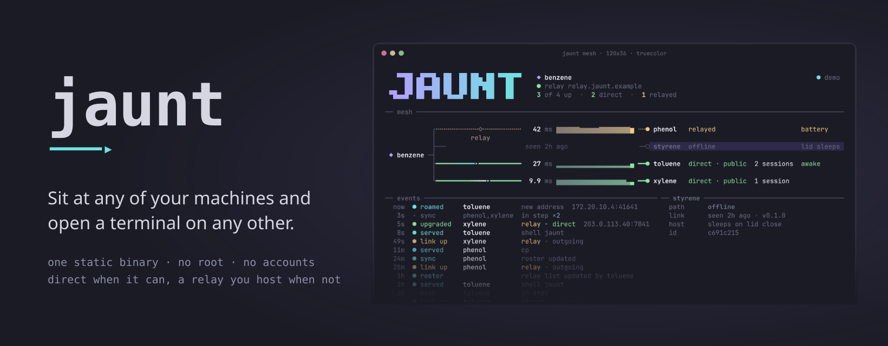
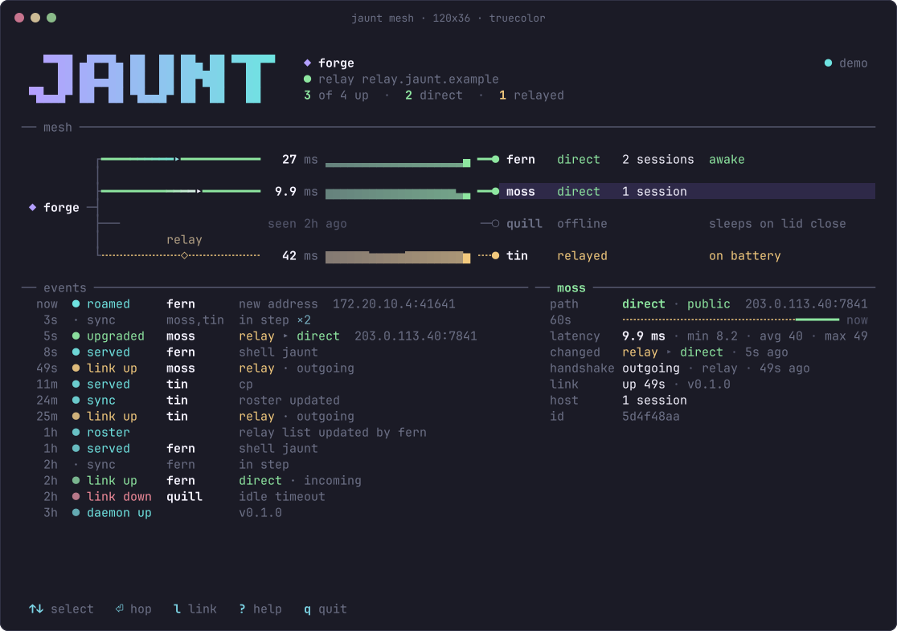
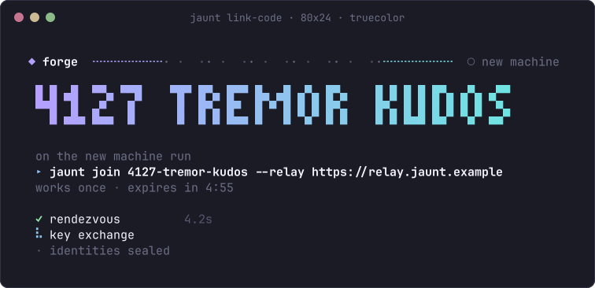
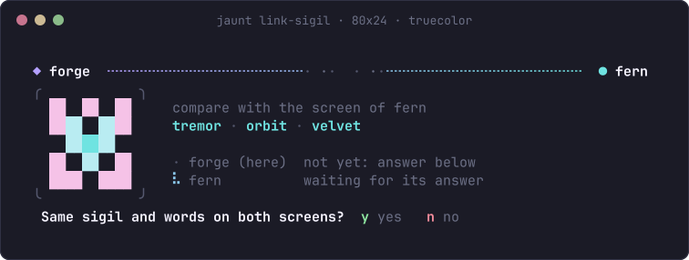

<p align="center"></p>

<p align="center">
  <a href="https://github.com/ZahakJ/jaunt/releases/latest"></a>
  <a href="LICENSE"></a>
  <a href="https://zahakj.github.io/jaunt/manual/"></a>
  
</p>

# jaunt

jaunt lets you sit at any of your own machines and open a terminal on any other one: `jaunt toluene` puts you in a tmux session on the machine called toluene, over a direct encrypted link when one can be made and through a relay you run when it cannot.



*`jaunt` with no arguments: the live mesh. Solid green is a direct path, dashed amber goes through the relay. (This picture is `jaunt demo`; try it before setting anything up.)*

```sh
curl -fsSL https://raw.githubusercontent.com/ZahakJ/jaunt/main/install.sh | sh -s -- --name benzene
~/.local/bin/jaunt demo
```

One static binary in `~/.local/bin`, no root. Options to the installer go after `sh -s --`; without options, `| sh` is enough. Linux x86_64 has a release binary; anything else builds from source.

> **Keep your Cloudflare tunnel for now.** jaunt is new, has had no outside security review, and has only been tested in a simulated network lab. Leave the SSH-through-Cloudflare path in place until jaunt has proven itself on your real machines.

## Set it up

The example: a desktop called **benzene** and a laptop called **toluene**.

**1. A relay.** Your machines need one small meeting point on the internet that you run yourself. It introduces them to each other, carries the traffic when they cannot connect directly, and only ever sees encrypted data. One relay serves every machine you will ever link, and the cheapest option is free: your desktop, behind a Cloudflare tunnel you already have. The options, their costs, and why Fly.io gives no direct paths as shipped: [the relay chapter](https://zahakj.github.io/jaunt/manual/relay.html) and [deploy/relay/README.md](deploy/relay/README.md). No relay yet? [Try jaunt on one machine](docs/try-it.md) with a local test relay.

**2. On the desktop (benzene):**

```sh
jaunt relay set https://relay.example.net
jaunt up        # start the background service
jaunt link      # shows a code like 4127-tremor-kudos
```



**3. On the laptop (toluene):**

```sh
curl -fsSL https://raw.githubusercontent.com/ZahakJ/jaunt/main/install.sh | sh -s -- --name toluene
jaunt up
jaunt join --relay https://relay.example.net     # asks for the code; type it
```

Both screens show the same small picture and three words. If they match, press `y` on both. If they do not, press `n`.



More machines join the same way, from any machine already linked. The others learn about the new one by themselves.

## Use it

| Command | Does |
| --- | --- |
| `jaunt` | the live mesh view: arrows to choose, Enter to hop, `q` to quit |
| `jaunt toluene` | hop to toluene (same session every time; `jaunt toluene:work` for another) |
| `jaunt ls` | every machine: direct, relayed or offline, latency, sessions |
| `jaunt run toluene -- uname -a` | run one command there |
| `jaunt cp notes.txt toluene:docs/` | copy files, either direction |
| `jaunt fwd toluene 8080` | reach a port on toluene from here |
| `jaunt host on` | on a laptop: stay reachable with the lid closed (below) |
| `jaunt unlink toluene` | revoke a machine |
| `jaunt check` | diagnose problems |

**Getting out:** press Enter, then `~`, then `.`. Your session stays on the other machine, and `jaunt toluene` brings you back to exactly where you were. If the connection drops (lid closed, Wi-Fi gone), jaunt waits and re-attaches by itself.

All commands: [docs/commands.md](docs/commands.md). Using it from inside tmux (a popup picker on prefix `J`, and `F12` to talk to the tmux on the other machine): [docs/tmux.md](docs/tmux.md).

## Laptops that stay reachable

A laptop that sleeps when its lid closes cannot be hopped into. `jaunt host on` on the laptop keeps it awake with the lid closed **only while it is plugged in and not too hot**; `jaunt host status` says what closing the lid would do right now. On battery, when hot, or when jaunt cannot tell, it sleeps as usual, so it will not cook in a bag. Linux only, and not yet tried on a real laptop. Details and the safety rules: [docs/awake.md](docs/awake.md).

## If a laptop is lost

From any other machine, `jaunt unlink toluene --kill-sessions`. It is cut off at once on every machine that is online, and the output lists any machine that has not heard yet. What this does and does not undo: [docs/security.md](docs/security.md#revoking-a-lost-laptop).

## How it works, briefly

```
 your terminal                                               the other machine
 jaunt toluene ── daemon ════ QUIC + TLS 1.3 ════ daemon ── tmux session
                     │   direct when possible        │
                     └──── else through the relay ───┘
```

Each machine runs a small background service holding its own key. Machines only accept keys on the shared member list, checked during the encrypted handshake. The networking and encryption come from the [iroh](https://iroh.computer) library, not from jaunt; jaunt adds the linking ritual, the member list and revocation, the hop commands, the mesh view and the lid guard. Sessions live in tmux on the far machine, which is why they survive disconnects.

## What you should know before trusting it

- **Tested only in simulation.** A Docker lab with three machines behind simulated home routers passes 250 end-to-end checks. No real laptop, lid, relay server, home network or Mac has run it. [What was tested](docs/testing.md) · [First real-world test checklist](docs/first-real-test.md)
- **No outside audit.** Not of jaunt, nor of the iroh library under it, nor of the SPAKE2 crate the pairing uses. Releases are not signed: the installer's checksum comes from the same place as the binary, so it catches a broken download, not a malicious release. A stolen, unlocked laptop is a full member until you revoke it. [Security, threat model and the comparison with Cloudflare and Tailscale](docs/security.md)
- **Speed.** In the lab a keystroke took 81 ms on jaunt's direct path against 121 to 139 ms for SSH through a relay host, with 20 ms of simulated delay per router. The gain is the direct path; through the relay jaunt is no faster than SSH. [Numbers and method](docs/testing.md)
- **Choices made for you, and the ones that are yours** (where the relay runs, when to retire the Cloudflare path): [docs/decisions.md](docs/decisions.md)

## Documents

- The home page: <https://zahakj.github.io/jaunt/>
- The manual: <https://zahakj.github.io/jaunt/manual/>. Chapters: install, pairing, hopping, host mode, the relay, try it on one machine, security model, internals, troubleshooting, what was tested, decisions, changelog.
- In this repository: [docs/DESIGN.md](docs/DESIGN.md) (the design), [docs/security.md](docs/security.md), [docs/testing.md](docs/testing.md), [docs/research/](docs/research/) (the survey of alternatives), [deploy/relay/README.md](deploy/relay/README.md) (hosting the relay).

**Uninstall:** `jaunt uninstall` (asks before deleting the key), then `jaunt unlink <name>` from another machine.

**Build from source:** `cargo build --release`; tests with `cargo test`; the lab with `test/e2e/run-all.sh` (Docker, no root).

**Contributing and reporting security problems:** [CONTRIBUTING.md](CONTRIBUTING.md), [SECURITY.md](SECURITY.md).

License: MIT.
